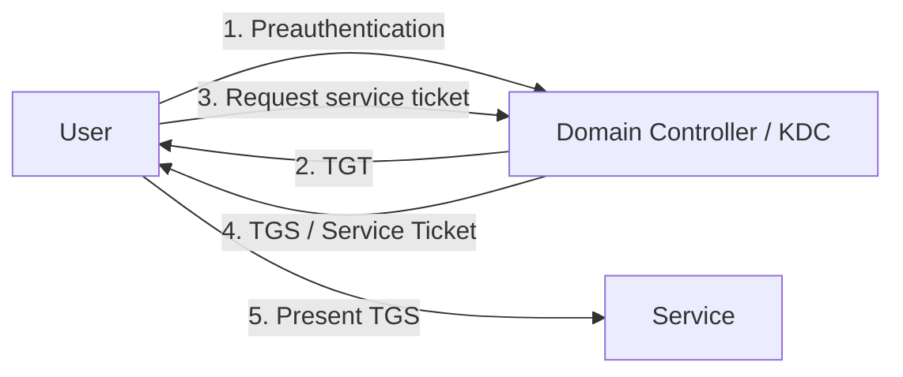
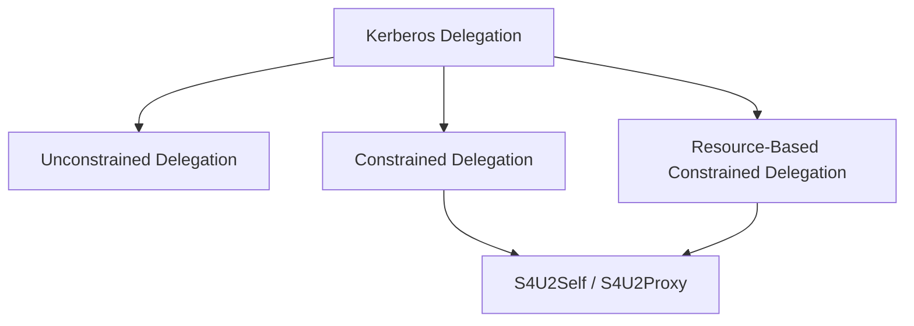
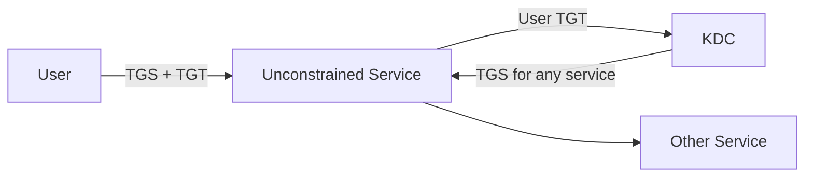
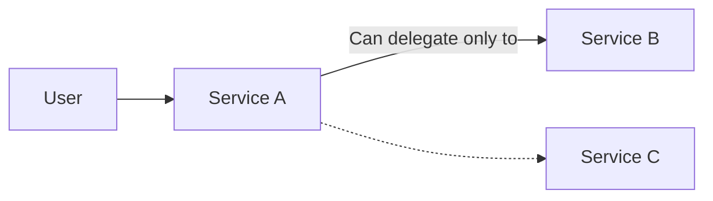
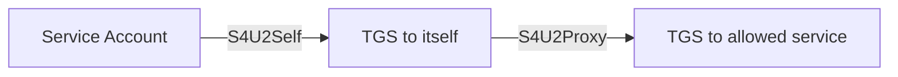
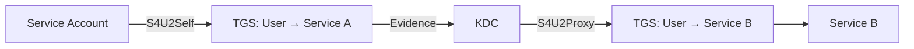
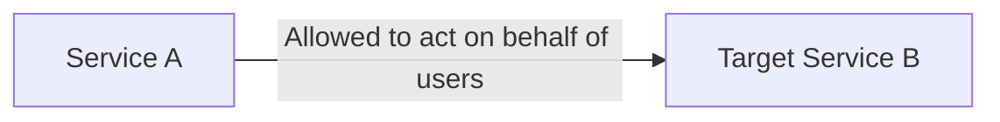
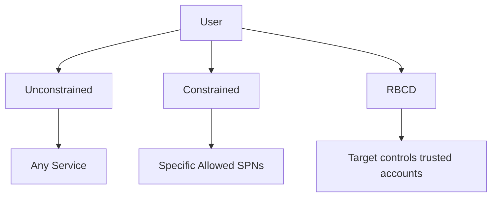

## Kerberos Overview
Kerberos is the authentication protocol used by Active Directory.



### Basic Flow

1. **Preauthentication** — User proves knowledge of their password by encrypting a timestamp with a key derived from the password.
2. **TGT** — The KDC issues a **Ticket Granting Ticket**.
3. **TGS Request** — User uses the TGT to request access to a service.
4. **TGS** — KDC issues a service ticket for the requested service.
5. **Authentication** — User presents the TGS to the service.

### Tickets
- Every ticket has a **clear-text** and **encrypted** part.
- The clear-text part contains the target **SPN**.
- The encrypted part is protected using a key derived from the **target service account's password**.
- A **TGT** is encrypted using the password-derived key of `krbtgt`.
- TGT SPN:
```text
krbtgt/DOMAIN
```

---

# Kerberos Delegation

Delegation allows a service to **act on behalf of a user** when accessing another service.

There are three main concepts:



---

# 1. Unconstrained Delegation

The service receives the user's **TGT** and can use it to request tickets to **any service** on behalf of that user.



### Why it is dangerous

If an attacker compromises a server configured for unconstrained delegation:
1. A user authenticates to the server.
2. The user's TGT can be placed in the server's memory.
3. The attacker may extract the TGT.
4. The TGT can be reused to impersonate that user to other services.

```text
User → Unconstrained Server → TGT stored in LSASS → Attacker → Other Services
```

### Finding Unconstrained Delegation

The relevant `userAccountControl` flag is:
```text
TRUSTED_FOR_DELEGATION
```

LDAP filter:
```text
(userAccountControl:1.2.840.113556.1.4.803:=524288)
```

---

# 2. Constrained Delegation

Constrained delegation limits a service to impersonating users only to **specific services**.

The allowed services are stored in:
```text
msDS-AllowedToDelegateTo
```

Example:



Service A can impersonate users to **Service B**, but not arbitrary services.

### Important Attribute
```text
msDS-AllowedToDelegateTo
```

This contains the SPNs that the account is allowed to delegate to.

---

# S4U

**S4U = Service for User**

S4U extensions allow a service to request Kerberos tickets **on behalf of a user**.

There are two important operations:



## S4U2Self

Allows a service to request a service ticket **to itself** on behalf of another user.

```text
Service → KDC
        "Give me a ticket to myself as User"
```

The user's password is **not required**.

S4U2Self is associated with:
```text
TRUSTED_TO_AUTH_FOR_DELEGATION
```

This is also called **Protocol Transition** because the user may have originally authenticated using something other than Kerberos.

Example:
```text
User
  ↓
Web App
  ↓
S4U2Self
  ↓
TGS for User → Web App
```

---

## S4U2Proxy

Uses the S4U2Self ticket as **evidence** to request a ticket to another service.



The KDC checks whether Service A is allowed to delegate to Service B.

For classic constrained delegation, this is controlled by:
```text
msDS-AllowedToDelegateTo
```

The ticket used as evidence must have the **FORWARDABLE** flag.

---

# 3. Resource-Based Constrained Delegation (RBCD)

RBCD is similar to constrained delegation, but the configuration works in the **opposite direction**.

### Classic Constrained Delegation

Configured on **Service A**:
```text
Service A
    |
    | msDS-AllowedToDelegateTo
    ↓
Service B
```

Meaning:
> Service A is allowed to delegate to Service B.

### RBCD

Configured on **Service B**:
```text
Service A
    |
    ↓
Service B
    |
    | msDS-AllowedToActOnBehalfOfOtherIdentity
```

Meaning:
> Service B allows Service A to act on behalf of users to it.



The relevant attribute is:
```text
msDS-AllowedToActOnBehalfOfOtherIdentity
```

---

# Important Delegation Flags

|Feature|Important Setting|Main Idea|
|---|---|---|
|Unconstrained|`TRUSTED_FOR_DELEGATION`|Service can use user's TGT broadly|
|Constrained|`msDS-AllowedToDelegateTo`|Service can delegate to specific SPNs|
|Protocol Transition|`TRUSTED_TO_AUTH_FOR_DELEGATION`|Enables S4U2Self|
|RBCD|`msDS-AllowedToActOnBehalfOfOtherIdentity`|Target controls who can delegate to it|

---

# Delegation Comparison



### Key Difference

**Unconstrained:**
```text
Service → Any Service
```

**Constrained:**
```text
Service A → Specific Services
```

**RBCD:**
```text
Target Service → Defines which accounts may delegate to it
```

---

# Delegation Protections

A user configured as:
```text
Account is sensitive and cannot be delegated
```

has the `USER_NOT_DELEGATED` attribute.
Members of **Protected Users** are also protected against delegation.
These accounts will not have the **FORWARDABLE** behavior required for the relevant delegation flow.

## Remember
```text
TGT
 ↓
Proves identity to KDC

TGS
 ↓
Proves identity to a specific service

S4U2Self
 ↓
Get a ticket to yourself as another user

S4U2Proxy
 ↓
Use that ticket as evidence to access another allowed service

RBCD
 ↓
Target decides who is allowed to delegate to it
```

## **Resources**
https://eladshamir.com/2019/01/28/Wagging-the-Dog.html
https://harmj0y.medium.com/s4u2pwnage-36efe1a2777c